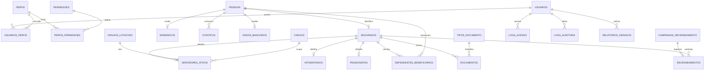

# GitHub Codespaces ♥️ React

Welcome to your shiny new Codespace running React! We've got everything fired up and running for you to explore React.

You've got a blank canvas to work on from a git perspective as well. There's a single initial commit with the what you're seeing right now - where you go from here is up to you!

Everything you do here is contained within this one codespace. There is no repository on GitHub yet. If and when you’re ready you can click "Publish Branch" and we’ll create your repository and push up your project. If you were just exploring then and have no further need for this code then you can simply delete your codespace and it's gone forever.

This project was bootstrapped for you with [Vite](https://vitejs.dev/).

## Available Scripts

In the project directory, you can run:

### `npm start`

We've already run this for you in the `Codespaces: server` terminal window below. If you need to stop the server for any reason you can just run `npm start` again to bring it back online.

Runs the app in the development mode.\
Open [http://localhost:3000/](http://localhost:3000/) in the built-in Simple Browser (`Cmd/Ctrl + Shift + P > Simple Browser: Show`) to view your running application.

The page will reload automatically when you make changes.\
You may also see any lint errors in the console.

### `npm test`

Launches the test runner in the interactive watch mode.\
See the section about [running tests](https://facebook.github.io/create-react-app/docs/running-tests) for more information.

# Aurora Previdencia Municipal

Base inicial de um sistema de cadastramento previdenciario, com frontend React/Vite e API FastAPI. PostgreSQL e o alvo do compose; SQLite e suportado para desenvolvimento e testes. O painel atual usa dados demonstrativos e ainda nao consome a API.

## Arquitetura

```text
.
├── backend/app/             # API, configuracao, modelos, schemas, services e repositories
├── backend/migrations/      # Alembic e revisoes versionadas
├── backend/tests/           # testes pytest/httpx
├── src/                     # aplicacao React/Vite
├── docker-compose.yml       # API, frontend e PostgreSQL
├── Dockerfile.frontend
└── requirements.txt
```

A API segue `routers (app/api.py) -> services -> repositories -> models/schemas`; as rotas estao em `/api/v1` e o OpenAPI em `/docs`. Dados de segurados e logs ficam em tabelas distintas, CPF e validado e mascarado nas listagens/relatorios. Campos bancarios possuem utilidade de cifragem Fernet; a chave deve ser criada e protegida fora do banco.

## DER



Cadastros mutaveis usam `created_at`, `updated_at`, `deleted_at` e `created_by`; logs sao append-only. A revisao `backend/migrations/versions/a3ee36c49c77_initial_relational_schema.py` cria tabelas, indices e constraints. O seed e repetivel.

## Entrega por etapa

1. **Arquitetura:** monorepo React/FastAPI e separacao em API, services, repositories, modelos, schemas e migracoes. Falta extrair cada dominio em routers proprios. Validacao: consulte `/docs` e `backend/app`.
2. **DER/persistencia:** entidades para usuarios/perfis/permissoes, pessoas, vinculos, documentos, recenseamento, auditoria, acessos e relatorios; revisao Alembic inicial. Falta testar PostgreSQL e ligar schemas/endpoints de enderecos, contatos e dados bancarios. Validacao: `PYTHONPATH=backend alembic -c backend/alembic.ini upgrade head`.
3. **API:** JWT access/refresh com rotacao, Argon2, rate limit, bloqueio apos cinco falhas, RBAC, cadastro dos tres vinculos, soft delete, upload validado, analise documental, campanhas, recenseamentos, dashboards e sete tipos de relatorio CSV/XLSX/PDF. Faltam recuperacao de senha via provedor, edicao/historico completos, dependentes/endereco/contato/banco, self-service, lista de nao recenseados e exportacao pesada em background. Upload local deve ser trocado por bucket privado com antivirus e retencao em producao. Validacao: `PYTHONPATH=backend pytest -q backend/tests`.
4. **Frontend:** painel responsivo, navegacao por modulos, indicadores, atividade e aviso explicito de demonstracao. Falta login, rotas protegidas React Router, contexto, Axios com refresh, TanStack Query ligado a API, CRUDs e graficos reais. A navegacao atual nao substitui esses fluxos. Validacao: `npm test -- --run` e `npm run build`.
5. **Infra/testes:** compose com API, frontend, PostgreSQL, `.env.example`, seed de perfis/tipos/admin e testes basicos. Falta cobertura de 70%, lint/format automaticos, CI e auditoria de seguranca das imagens. A base nao satisfaz ainda os criterios de producao. Validacao: veja os comandos abaixo.

## Executar

Requisitos: Python 3.11+, Node 22+, npm e Docker Compose v2.

```bash
cp .env.example .env
```

Troque `POSTGRES_PASSWORD`, `JWT_SECRET_KEY` e `ADMIN_PASSWORD` antes de qualquer uso externo. Gere uma chave Fernet com `python -c "from cryptography.fernet import Fernet; print(Fernet.generate_key().decode())"` e coloque em `BANK_ENCRYPTION_KEY`.

```bash
docker compose up --build
```

Frontend: `http://localhost:3000`  
API: `http://localhost:8000`  
OpenAPI: `http://localhost:8000/docs`  
Health: `http://localhost:8000/health`

Seed inicial: CPF `52998224725`, email `admin@example.local`, senha `ChangeMe!2026` (ou os valores configurados por `ADMIN_CPF`, `ADMIN_EMAIL` e `ADMIN_PASSWORD`). Troque as credenciais imediatamente. Senhas exigem 12 caracteres, maiuscula, minuscula, numero e simbolo.

### API local com SQLite

```bash
python3 -m venv .venv
. .venv/bin/activate
pip install -r requirements.txt
export PYTHONPATH=backend DATABASE_URL=sqlite:///./aurora.db
export JWT_SECRET_KEY=local-dev-secret-with-at-least-32-characters
export ADMIN_CPF=52998224725 ADMIN_PASSWORD='ChangeMe!2026'
alembic -c backend/alembic.ini upgrade head
python -m app.seed
uvicorn app.main:app --reload --port 8000
```

### Chamadas de exemplo

```bash
curl -X POST http://localhost:8000/api/v1/auth/login \
	-H 'Content-Type: application/json' \
	-d '{"cpf":"52998224725","password":"ChangeMe!2026"}'

curl 'http://localhost:8000/api/v1/segurados?page=1&page_size=20' \
	-H 'Authorization: Bearer ACCESS_TOKEN'

curl -X POST http://localhost:8000/api/v1/relatorios \
	-H 'Authorization: Bearer ACCESS_TOKEN' -H 'Content-Type: application/json' \
	-d '{"type":"segurados_por_vinculo","format":"csv","filters":{}}' -o segurados.csv
```

### Testes

```bash
npm test -- --run
npm run build
PYTHONPATH=backend pytest -q backend/tests
```

A cobertura ainda e inicial, abaixo do minimo solicitado. Nao use dados, credenciais ou armazenamento de demonstracao para tratar dados pessoais reais sem completar revisao de seguranca, LGPD, retencao, backups e controles de acesso.
